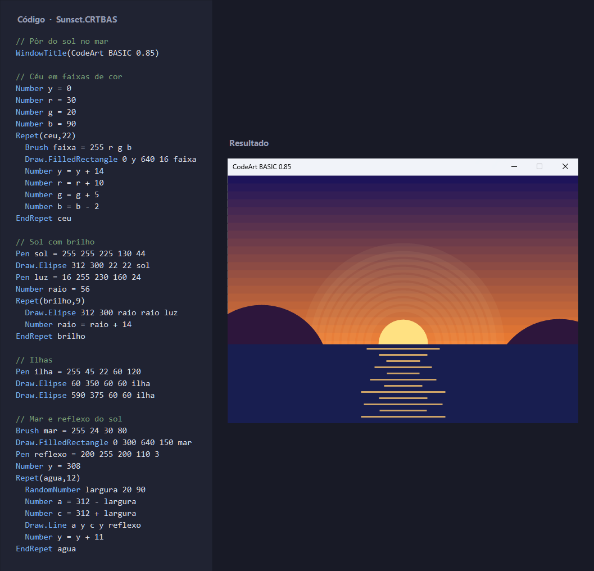

# CodeArt 0.85
Uma simples linguagem de programação criada em C# com objetivo de se criar desenhos com comandos.
É uma linguagem interpretada.

O código da imagem está em [Binaries/Examples/Sunset.CRTBAS](Binaries/Examples/Sunset.CRTBAS).

- 2015
- Versão 0.85: 2026
